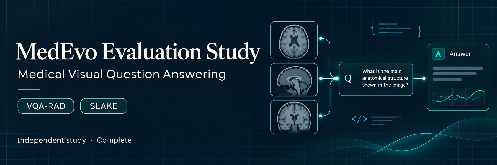

# MedEvo Evaluation Study



An independent, reduced-scale evaluation of
[MedEvo: Medical Reasoning Evolution through Knowledge Navigation](https://arxiv.org/abs/2610.17690)
on the VQA-RAD and SLAKE medical visual question answering benchmarks, run on a single CPU workstation.

The authors' code, training data and weights have not been released, so this repository implements the
method's core loop independently: sample reasoning from a primary model, keep verified correct rollouts,
let a reference-free auditor locate the first error in failed rollouts, regenerate from the supported prefix
with a minimal hint, admit only checked examples, and fine-tune with LoRA. All decisions that could
affect results (prompt, output budget, metrics, test subset) are fixed on feedback data before any
test-set generation.

**Status:** Phases 1-4 complete: frozen protocol, test baselines, a 43-example training bank and a LoRA
adapter for Qwen3.5-2B. The adapted-model evaluation (Phase 5) follows.
See [Project status](#project-status).

## Results

Reserved test subsets: 200 questions per dataset, stratified by open/closed answer type. Accuracy in %,
95% bootstrap intervals in brackets. Primary metric: normalized exact match of the final `\boxed{}` answer.

| Model | VQA-RAD | SLAKE | Overall |
|---|---|---|---|
| Qwen3.5-9B, Ollama Q4_K_M | 56.5 [49.5, 63.5] | 57.5 [50.5, 64.0] | 57.0 [52.2, 61.8] |
| Qwen3.5-2B, bfloat16 | 15.5 [11.0, 20.5] | 27.5 [21.5, 33.5] | 21.5 [17.5, 25.5] |
| Qwen3.5-2B, secondary metric¹ | 47.5 [40.5, 54.5] | 46.5 [39.5, 53.5] | 47.0 [42.0, 51.7] |
| *Paper: Qwen3.5-9B base* | *68.10* | *76.80* | |
| *Paper: Qwen3.5-9B + MedEvo* | *70.40* | *78.23* | |

¹ Reads a boxed `1`/`0` as yes/no on yes/no questions (protocol amendment 01). Qwen3.5-2B did this in
190 of 400 answers, so most of its primary-metric errors are answer-format errors.

The paper's numbers use full benchmarks, full-precision weights and MedUniEval scoring. Most of the gap to
our Qwen3.5-9B result is on open-ended questions (VQA-RAD 28.1%, SLAKE 41.0%), where strict exact
match rejects equivalent wording; closed questions score 79.3% and 83.3%.

Phase 3 training bank (100 training questions, 4 rollouts each): **43 examples**, 40 verified correct
rollouts and 3 admitted repairs.

| Stage | Result |
|---|---|
| v1 audit (instruction did not state that the trajectory failed) | 60 of 60 failures skipped, 0 repairs |
| v2 re-audit (aligned with MedEvo Appendix D.3) | repair proposed for 58 of 60 failures |
| Continuations (up to 5 per failure, 280 total) | 268 still incorrect; 10 correct and clean |
| Learnability gates (paper thresholds) | 3 admitted |

Most proposed errors were visual misreadings (52 V, 6 K). The binding constraint was the 2B model's ability
to correct itself after a hint. In 31 failures the only problem was a boxed `1`/`0`; the reference-free
auditor treated these as reasoning errors, and the model kept boxing `1`/`0` in 112 continuations.

Full tables and per-question records: [results/](results/README.md).

## Method

| Component | MedEvo paper | This study |
|---|---|---|
| Primary (trained) model | Qwen3.5-9B / 35B / 397B | Qwen3.5-2B, trainable on CPU |
| Reference model | — | Qwen3.5-9B, evaluated unadapted |
| Auditor | GPT-5.6-sol, reference-free | Qwen3.5-9B via Ollama, reference-free |
| Rollouts per question | 8 | 4 |
| Error localization | entropy proposal + audit | audit only |
| Admission | answer, boundary, integrity, learnability | answer, boundary range, integrity, hint-leak guard, learnability (paper thresholds, v2) |
| Continuations per repair | up to 5 | up to 5 |
| Rounds | 3, feedback-guided | 1 |
| Training | SFT | LoRA (rank 16) on language-model layers |

The reference answer is used only to verify correctness and to reject hints that reveal it; it is never
sent to the primary model or the auditor.

## Repository layout

```
├── medevo_study/            Frozen-protocol pipeline: data, scoring, backends, Phase 3 logic
├── src/                     Data preparation, evaluation and earlier experiment modules
├── configs/                 Data sources and earlier experiment configurations
├── data/benchmarks/         Split manifests (images distributed separately, see data/README.md)
├── results/                 Protocol, test baselines, feedback runs, training bank
├── docs/                    Protocol, data sources, setup, run guide
│   ├── experiments/         Notes from Phase 1–2 experiments
│   └── verification/        Verification records and test logs
├── tests/
├── freeze_protocol.py       Fix prompt, budget, metrics and test subset
├── prepare_primary_model.py Pin and check Qwen3.5-2B
├── run_test_evaluation.py   Evaluate a system on the frozen questions
├── build_training_bank.py   Phase 3 collection (v1)
├── reaudit_failures.py      Phase 3 re-audit with the MedEvo audit prompt (v2)
├── train_adapter.py         Phase 4 LoRA training
└── compile_results.py       Result tables and report draft
```

The remaining top-level scripts (`evaluate.py`, `evaluate_feedback.py`, `check_*.py` and others) are the
Phase 1–2 entry points; they are documented in [docs/experiments](docs/experiments/).

## Getting started

Requirements: Python 3.12, about 16 GB of free RAM, [Ollama](https://ollama.com) for Qwen3.5-9B.
The recorded environment is Windows 11 on an AMD Ryzen 7 9800X3D with 32 GB RAM, CPU only.

```powershell
py -V:3.12 -m venv .venv312
$py = '.\.venv312\Scripts\python.exe'
& $py -m pip install torch==2.15.0 torchvision==0.29.2 --index-url https://download.pytorch.org/whl/cpu
& $py -m pip install -r requirements.txt
ollama pull qwen3.5:9b
```

Get the benchmark images (see [data/README.md](data/README.md)), then check the installation:

```powershell
& $py evaluate.py inspect
& $py -m unittest discover -s tests -v
```

## Reproducing the study

The full sequence, with expected run times, is in [docs/running_the_study.md](docs/running_the_study.md):

```powershell
& $py freeze_protocol.py --per-dataset 200
& $py run_test_evaluation.py --system baseline
& $py prepare_primary_model.py
& $py run_test_evaluation.py --system primary
& $py build_training_bank.py --questions 100
& $py reaudit_failures.py
& $py train_adapter.py --epochs 2
& $py run_test_evaluation.py --system adapted --adapter-dir outputs\adapter_v1\adapter
& $py compile_results.py
```

Long runs are resumable: re-running a command continues from the last completed question.
The protocol used for the reported results is in [results/protocol/](results/protocol/);
`freeze_protocol.py` refuses to overwrite an existing protocol.

## Evaluation protocol

- Prompt (paper, Appendix D.1): `Please reason step by step, and put your final answer within \boxed{}.`
- Output budget: 1024 tokens, chosen on feedback questions before any test run.
- Decoding: greedy for evaluation; sampled (temperature 0.7, top-p 0.8, top-k 20) for Phase 3 rollouts.
- Metrics: primary and secondary exact match, token F1, boxed-answer rate, truncations, latency.
- Uncertainty: percentile bootstrap (10,000 resamples); paired bootstrap and exact McNemar test
  for systems evaluated on the same questions.
- Data roles: training questions are used only in Phase 3, feedback questions only for protocol
  decisions, and test questions only for final evaluation.

Frozen protocol: [results/protocol/protocol.json](results/protocol/protocol.json). Phase 2 evaluation
protocol: [docs/protocol.md](docs/protocol.md).

## Project status

| Phase | Scope | Status |
|---|---|---|
| 1 | Environment and CPU feasibility | Complete |
| 2 | Data preparation and evaluation infrastructure | Complete |
| 3 | Frozen protocol, test baselines, training bank | Complete (bank v2: 43 examples) |
| 4 | LoRA adaptation of Qwen3.5-2B | Complete (43 examples, 2 epochs, 11 optimizer steps) |
| 5 | Adapted-model evaluation and technical report | Pending |

## Limitations

- Independent implementation of a reduced MedEvo loop; not the authors' code and not a reproduction of
  their published scores.
- Smaller trainable model, quantized reference model, CPU execution and a much weaker auditor than the paper.
- 200-question test subsets give intervals of about ±7 points, too wide to resolve the paper's 1–2 point gains.
- Lexical scoring; model readings and reference answers were not clinically adjudicated.
- Splits separate exact images only; patient-level and near-duplicate separation are not established.

## Citation

If you use this repository, please cite the original method and datasets:

```bibtex
@article{wang2026medevo,
  title   = {MedEvo: Medical Reasoning Evolution through Knowledge Navigation},
  author  = {Wang, Xiaoliang and Chen, Zhuo and Zheng, Chuanyang and Wang, Quanbin and Lao, Jiangwei
             and Liu, Yingao and Liu, Jiajia and Cao, Jinming and Lin, Honglin and Lu, Zhihong
             and Jin, Hao and Wang, Jian and Wu, Lijun},
  journal = {arXiv preprint arXiv:2610.17690},
  year    = {2026}
}
```

Citation metadata for this repository is in [CITATION.cff](CITATION.cff). Dataset citations are listed in
[data/README.md](data/README.md); further references in [docs/references.md](docs/references.md).

## License

Code and documentation: [MIT](LICENSE). Benchmark data keeps its original licenses
(VQA-RAD: CC0 1.0; SLAKE: CC BY 4.0).
