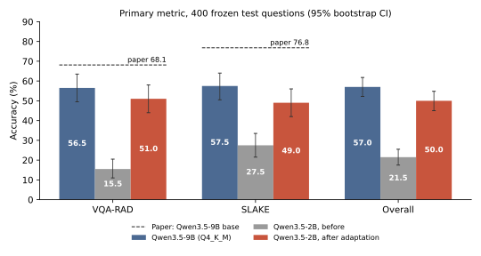
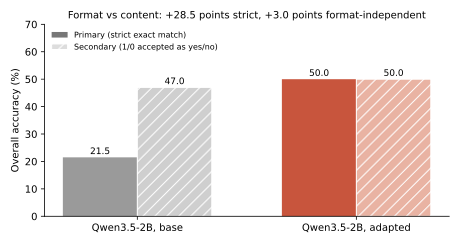
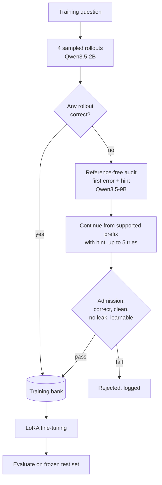
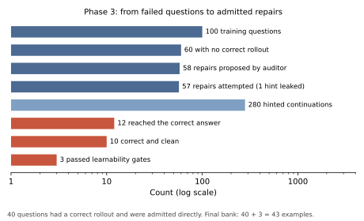

# MedEvo Evaluation Study

[](https://www.python.org/)
[](LICENSE)
[](https://arxiv.org/abs/2610.17690)
[](data/README.md)


An independent, reduced-scale evaluation of
[MedEvo: Medical Reasoning Evolution through Knowledge Navigation](https://arxiv.org/abs/2610.17690)
on the VQA-RAD and SLAKE medical visual question answering benchmarks, run on a single CPU workstation.

The authors' training code, data and weights have not been released, so this repository implements the
method's core loop independently: sample reasoning from a primary model, keep verified correct rollouts,
let a reference-free auditor locate the first error in failed rollouts, regenerate from the supported prefix
with a minimal hint, admit only checked examples, and fine-tune with LoRA. The prompt, output budget, primary
metric and test subset were fixed on feedback data before any test-set generation.

**Status:** complete. About 4 days of development and about 15 hours of CPU computation
(see [Compute](#compute)).

## Key findings

1. **One round of MedEvo-style training raised Qwen3.5-2B from 21.5% to 50.0%** on 400 held-out test
   questions (+28.5 points, 95% CI [23.5, 33.5], McNemar p < 0.001), using 43 training examples.
2. **Most of the gain is answer format.** Before training the model boxed `1`/`0` instead of yes/no in 190 of
   400 answers; after training, 10. With `1`/`0` accepted as yes/no, the gain is +3.0 points (p = 0.17).
3. **A possible content gain on VQA-RAD open questions:** 15.7% → 24.7% (+9.0 points, p = 0.057), not
   conclusive at this sample size.
4. **The repair step yielded little at 2B scale.** The auditor proposed repairs for 58 of 60 failed answers,
   but 268 of 280 hinted continuations were still wrong; 3 repairs were admitted.
5. **Qwen3.5-9B scores below the paper** (57.0% overall), mainly on open questions where strict exact match
   rejects equivalent wording; its closed-question accuracy is 79.3% (VQA-RAD) and 83.3% (SLAKE).

## Results

Reserved test subsets: 200 questions per dataset, stratified by open/closed answer type. Accuracy in %,
95% bootstrap intervals in brackets. Primary metric: normalized exact match of the final `\boxed{}` answer.



| Model | Metric | VQA-RAD | SLAKE | Overall |
|---|---|---|---|---|
| Qwen3.5-9B, Ollama Q4_K_M | primary | 56.5 [49.5, 63.5] | 57.5 [50.5, 64.0] | 57.0 [52.2, 61.8] |
| Qwen3.5-2B, base | primary | 15.5 [11.0, 20.5] | 27.5 [21.5, 33.5] | 21.5 [17.5, 25.5] |
| Qwen3.5-2B, adapted | primary | 51.0 [44.0, 58.0] | 49.0 [42.0, 56.0] | **50.0** [45.0, 54.8] |
| Qwen3.5-2B, base | secondary¹ | 47.5 [40.5, 54.5] | 46.5 [39.5, 53.5] | 47.0 [42.0, 51.7] |
| Qwen3.5-2B, adapted | secondary¹ | 51.0 [44.0, 58.0] | 49.0 [42.0, 56.0] | **50.0** [45.0, 54.8] |
| *Paper: Qwen3.5-9B base* | | *68.10* | *76.80* | |
| *Paper: Qwen3.5-9B + MedEvo* | | *70.40* | *78.23* | |

¹ Reads a boxed `1`/`0` as yes/no on yes/no questions (protocol amendment 01), separating answer format from
answer content.



| Paired effect of adaptation | Change | 95% CI | Fixed / broken | McNemar p |
|---|---|---|---|---|
| Primary metric | +28.5 | [23.5, 33.5] | 127 / 13 | < 0.001 |
| Secondary metric (format-independent) | +3.0 | [-1.0, 6.8] | 38 / 26 | 0.17 |

Results by question type, diagnostics, error analysis and the comparison with the paper:
**[docs/results.md](docs/results.md)**. Per-question records: [results/](results/README.md).

## How it works



| Role | Model | Runtime |
|---|---|---|
| Primary (trained) | Qwen3.5-2B | Transformers, LoRA rank 16 on language-model layers |
| Reference and auditor | Qwen3.5-9B, Q4_K_M | Ollama, CPU |

Phase 3 collected a **43-example training bank**: 40 verified correct rollouts and 3 admitted repairs.



Components, admission checks and learnability gates: **[docs/architecture.md](docs/architecture.md)**.

## Compute

One Windows 11 workstation: AMD Ryzen 7 9800X3D (8 cores), 32 GB RAM, no GPU.

| Work | Time |
|---|---|
| Development: code, tests, debugging, preliminary experiments | about 4 days |
| Test evaluations (3 systems × 400 questions) | 9.6 h |
| Phase 3 training bank (collection and re-audit) | 5.3 h |
| LoRA training (2 epochs, 43 examples) | 19 min |
| **Total computation** | **about 15 h** |

Stage-by-stage timeline: [docs/results.md](docs/results.md#compute-and-timeline).

## Getting started

Requirements: Python 3.12, about 16 GB of free RAM, [Ollama](https://ollama.com) for Qwen3.5-9B.

```powershell
py -V:3.12 -m venv .venv312
$py = '.\.venv312\Scripts\python.exe'
& $py -m pip install torch==2.15.0 torchvision==0.29.2 --index-url https://download.pytorch.org/whl/cpu
& $py -m pip install -r requirements.txt
ollama pull qwen3.5:9b
```

Get the benchmark images (see [Downloads](#downloads)), then check the installation:

```powershell
& $py evaluate.py inspect
& $py -m unittest discover -s tests -v
```

## Downloads

| Release | Contents | Size |
|---|---|---|
| [`data-v1`](https://github.com/MeazbahMehedi/medevo-evaluation/releases/tag/data-v1) | Prepared VQA-RAD and SLAKE images (`medevo-benchmark-images-v1.zip`) | 222 MB |
| [`adapter-v1`](https://github.com/MeazbahMehedi/medevo-evaluation/releases/tag/adapter-v1) | LoRA adapter for Qwen3.5-2B (`medevo-lora-adapter-v1.zip`) | 62 MB |

## Reproducing the study

**Re-running the reported study** uses the published frozen protocol:

1. Extract `medevo-benchmark-images-v1.zip` into `data/benchmarks/`. The scripts check the data hashes against
   the protocol and stop if they differ.
2. Copy the protocol to the folder the scripts read:

   ```powershell
   New-Item -ItemType Directory -Force outputs\frozen_protocol_v1 | Out-Null
   Copy-Item results\protocol\* outputs\frozen_protocol_v1\
   ```
3. Run the stages:

   ```powershell
   & $py run_test_evaluation.py --system baseline
   & $py run_test_evaluation.py --system primary
   & $py build_training_bank.py --questions 100
   & $py reaudit_failures.py
   & $py train_adapter.py --epochs 2
   & $py run_test_evaluation.py --system adapted --adapter-dir outputs\adapter_v1\adapter
   & $py compile_results.py
   ```

To evaluate the released adapter without retraining, pass its extracted folder as `--adapter-dir`.
Long runs are resumable: re-running a command continues from the last completed question.

**Starting a new experiment:** `freeze_protocol.py` builds a new protocol from feedback runs, which are not stored in
the repository. Run `evaluate_feedback.py` and `compare_feedback_budget.py` first (inspect, then run), then
`freeze_protocol.py --per-dataset 200` and `prepare_primary_model.py`. If the budget rule cannot decide, pass `--budget`
with `--reason`. Full guide: [docs/running_the_study.md](docs/running_the_study.md).

## Repository layout

```
├── medevo_study/            Frozen-protocol pipeline: scoring, backends, Phase 3 logic
├── src/                     Data preparation, evaluation and earlier experiment modules
├── configs/                 Data sources and earlier experiment configurations
├── data/benchmarks/         Split manifests (images in release data-v1)
├── results/                 Protocol, test results, feedback runs, training banks, adapter run
├── docs/                    Results, architecture, protocol, data sources, setup, run guide
├── tests/
├── freeze_protocol.py       Fix prompt, budget, metrics and test subset
├── prepare_primary_model.py Pin and check Qwen3.5-2B
├── run_test_evaluation.py   Evaluate a system on the frozen questions
├── build_training_bank.py   Phase 3 collection (v1)
├── reaudit_failures.py      Phase 3 re-audit with the MedEvo audit prompt (v2)
├── train_adapter.py         Phase 4 LoRA training
└── compile_results.py       Result tables
```

The remaining top-level scripts (`evaluate.py`, `evaluate_feedback.py`, `check_*.py` and others) are the
Phase 1–2 entry points, documented in [docs/experiments](docs/experiments/).

## Limitations

- Independent implementation of a reduced MedEvo loop (one round, four rollouts, a much weaker auditor, LoRA
  instead of full SFT); not the authors' code.
- Smaller trained model (2B) and a 4-bit quantized reference model.
- 200-question subsets give intervals of about ±7 points, too wide to resolve the paper's 1–2 point gains.
- Exact-match scoring penalizes equivalent wording; answers were not clinically checked.
- No run trained on the 40 correct rollouts alone, so the repairs' own effect cannot be separated.

## Citation

If you use this repository, please cite the original method and datasets:

```bibtex
@article{wang2026medevo,
  title   = {MedEvo: Medical Reasoning Evolution through Knowledge Navigation},
  author  = {Wang, Xiaoliang and Chen, Zhuo and Zheng, Chuanyang and Wang, Quanbin and Lao, Jiangwei
             and Liu, Yingao and Liu, Jiajia and Cao, Jinming and Lin, Honglin and Lu, Zhihong
             and Jin, Hao and Wang, Jian and Wu, Lijun},
  journal = {arXiv preprint arXiv:2610.17690},
  year    = {2026}
}
```

Citation metadata for this repository is in [CITATION.cff](CITATION.cff). Dataset citations are listed in
[data/README.md](data/README.md); further references in [docs/references.md](docs/references.md).

## License

Code and documentation: [MIT](LICENSE). Benchmark data keeps its original licenses
(VQA-RAD: CC0 1.0; SLAKE: CC BY 4.0).
