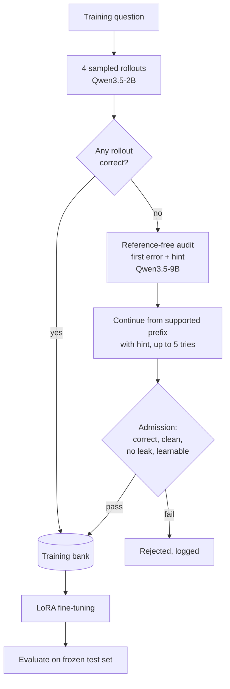

# Architecture

## Pipeline

## Systems

| Role | Model | Runtime |
|---|---|---|
| Primary (trained) | Qwen3.5-2B, revision `15852e8c` | Transformers 5.22.2, bfloat16 inference, float32 training |
| Reference and auditor | Qwen3.5-9B, GGUF Q4_K_M, digest `56671c2ab938` | Ollama 0.40.15, CPU, 4 threads, thinking off |
| Adapted | Qwen3.5-2B + LoRA adapter | Transformers + PEFT 0.21.2 |

The 9B model is the paper's base model but cannot be trained here: the GGUF build is not trainable, and float32
training of 9B parameters needs about 36 GB for the weights alone, more than the 32 GB workstation.

## Components

| Module | Responsibility |
|---|---|
| `medevo_study/core.py` | Paths, prompt, scorers, stratified sampling, step splitting, integrity checks, hint-leak guard, bootstrap and McNemar statistics, code and data hashing |
| `medevo_study/ollama_backend.py` | Qwen3.5-9B answering and reference-free audit with a JSON schema (v1 and v2 instructions) |
| `medevo_study/transformers_backend.py` | Qwen3.5-2B loading, generation with a prefilled prefix, per-token NLL with and without the task input, training examples with prompt masking |
| `medevo_study/collection.py` | Phase 3 logic: rollouts, audit, repair by continuation, admission and learnability gates |

| Script | Stage |
|---|---|
| `freeze_protocol.py` | Fix prompt, budget, primary metric and test subset |
| `prepare_primary_model.py` | Pin the Qwen3.5-2B revision and run a readiness check |
| `run_test_evaluation.py` | Evaluate a system (`baseline`, `primary`, `adapted`) on the frozen questions |
| `build_training_bank.py` | Phase 3 collection: rollouts and audit (v1) |
| `reaudit_failures.py` | Phase 3 re-audit and repair with the MedEvo audit prompt (v2) |
| `train_adapter.py` | Phase 4 LoRA training |
| `compile_results.py` | Result tables, paired statistics |

Every run records its settings, the model revision or digest, the protocol hash and SHA-256 hashes of the code
and data. Long runs save each question as it finishes and resume after an interruption. The test suite
(`tests/test_medevo_study.py`, 19 tests) covers scoring, sampling, statistics, admission checks and training-example
masking.

## Audit

The failed answer is split into numbered steps. The auditor receives the image, the question and the steps, but
not the reference answer, and returns JSON: action (`repair` or `skip`), first erroneous step, error type
(V visual, R inference, D differential, K knowledge), a one-sentence description and a hint of at most 30 words.
The v2 instruction follows the paper's Appendix D.3: it states that the trajectory failed verification and allows
`skip` only for format-only failures.

## Admission and learnability

A repaired continuation is admitted only if:

- its final answer is correct under the primary metric;
- it is not truncated, looping (more than 15% repeated 8-word sequences), too short (fewer than 5 words), or
  carrying thinking markup or more than three boxes;
- it does not copy the hint, and the hint does not contain the reference answer;
- it passes the paper's learnability gates:

| Gate | Definition | Range |
|---|---|---|
| D_repair | NLL of the repair with image and question / NLL without them (same prefix) | [0.35, 0.85] |
| Δ_repair | NLL of the repair − NLL of the original wrong continuation (same prefix and input) | [0.02, 0.30] |

The hint is used only to generate the repair; it is not part of either likelihood. The reference answer is used
only for verification and the hint-leak guard; it is never sent to the primary model or the auditor. The training
target is prefix + recovery cue (`Let me recheck the evidence. {hint}`) + repaired continuation.
