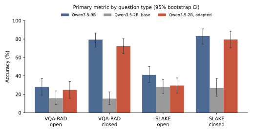
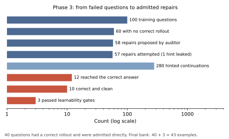
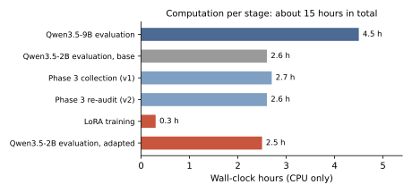

# Detailed results

All numbers are on the frozen test subsets (200 questions per dataset, 400 in total) unless stated otherwise.
Accuracy in %, 95% percentile bootstrap intervals (10,000 resamples) in brackets. Per-question records are in
[results/](../results/README.md).

- [Results by question type](#results-by-question-type)
- [Effect of adaptation](#effect-of-adaptation)
- [Output diagnostics](#output-diagnostics)
- [Training bank (Phase 3)](#training-bank-phase-3)
- [Training (Phase 4)](#training-phase-4)
- [Compute and timeline](#compute-and-timeline)
- [Analysis](#analysis)
- [Comparison with the paper](#comparison-with-the-paper)
- [Evaluation protocol](#evaluation-protocol)
- [Data](#data)

## Results by question type

Primary metric; secondary in brackets where it differs.

| Model | VQA-RAD open (n=89) | VQA-RAD closed (n=111) | SLAKE open (n=122) | SLAKE closed (n=78) |
|---|---|---|---|---|
| Qwen3.5-9B | 28.1 | 79.3 | 41.0 | 83.3 (84.6) |
| Qwen3.5-2B, base | 15.7 | 15.3 (73.0) | 27.9 | 26.9 (75.6) |
| Qwen3.5-2B, adapted | 24.7 | 72.1 | 29.5 | 79.5 |

Secondary metric for Qwen3.5-9B: 56.5 [49.5, 63.5] on VQA-RAD, 58.0 [51.0, 64.5] on SLAKE, 57.2 [52.5, 62.0] overall.

## Effect of adaptation

Paired comparison on the same questions. "Fixed" = wrong before, right after; "broken" = the reverse.

| Metric | Subset | Change | 95% CI | Fixed / broken | McNemar p |
|---|---|---|---|---|---|
| Primary | Overall | +28.5 | [23.5, 33.5] | 127 / 13 | < 0.001 |
| Primary | VQA-RAD | +35.5 | [28.5, 42.5] | 74 / 3 | < 0.001 |
| Primary | SLAKE | +21.5 | [14.5, 28.5] | 53 / 10 | < 0.001 |
| Primary | Closed | +55.0 | [47.6, 62.4] | 105 / 1 | < 0.001 |
| Primary | Open | +4.7 | [-0.5, 10.0] | 22 / 12 | 0.12 |
| Secondary | Overall | +3.0 | [-1.0, 6.8] | 38 / 26 | 0.17 |
| Secondary | Closed | +1.1 | [-4.8, 6.9] | 16 / 14 | 0.86 |
| Secondary | VQA-RAD open | +9.0 | [1.1, 16.9] | 11 / 3 | 0.057 |
| Secondary | SLAKE open | +1.6 | [-5.7, 9.0] | 11 / 9 | 0.82 |

For open questions the two metrics are identical. The adapted 2B model remains below the 9B reference:
-7.0 points overall (95% CI [-11.0, -3.0], p = 0.001). Subgroup p-values are not corrected for multiple
comparisons.

## Output diagnostics

| | Qwen3.5-9B | 2B base | 2B adapted |
|---|---|---|---|
| Answers with a `\boxed{}` | 94.8% | 98.8% | 99.5% |
| Truncated at 1024 tokens | 28 | 6 | 5 |
| Boxed `1`/`0` | 8 | 190 | 10 |
| Token F1 | 61.9% | 24.7% | 54.7% |
| Mean generated tokens | 356 | 207 | 209 |
| Mean time per question | 40.7 s | 23.0 s | 22.2 s |

## Training bank (Phase 3)

100 training questions (50 per dataset; 53 open, 47 closed), 4 sampled rollouts each (temperature 0.7,
top-p 0.8, top-k 20).

| Stage | Result |
|---|---|
| Questions with a correct, clean rollout | 40 (13 with one, 6 with two, 7 with three, 14 with four correct) |
| Questions with no correct rollout | 60 → audit |
| v1 audit (instruction did not state that the trajectory failed) | 60 of 60 skipped, 0 repairs |
| v2 re-audit (aligned with MedEvo Appendix D.3) | repair proposed for 58 (52 visual, 6 knowledge); 1 skip, 1 invalid |
| Hints rejected for leaking the answer | 1 |
| Continuations generated (up to 5 per repair) | 280 |
| Still incorrect | 268 |
| Correct and clean, checked for learnability | 10 |
| Admitted after learnability gates | **3** |

Other problems flagged on continuations: truncation 39, repetition 36, thinking markup 9, copying the hint 4,
too short 2, too many boxes 1. Of the 7 learnability rejections, 6 had Δ_repair above 0.30 and 1 was negative.

| Admitted repair | Auditor hint | Reference |
|---|---|---|
| is there a pneumothorax seen in the above image? | Re-examine the costophrenic angles and lower lung zones for blunting or opacity that may indicate pathology. | no |
| is the pancreas calcified? | Re-examine the pancreatic parenchyma for any hyperdense spots that would indicate calcification. | no |
| What diseases are included in the picture? | Re-examine the organ's location and shape relative to the stomach and diaphragm to confirm its identity. | Liver Cancer |

**Final bank (v2): 43 examples**, 40 correct rollouts and 3 repairs, 157 target tokens on average.

## Training (Phase 4)

| Setting | Value |
|---|---|
| Method | LoRA, rank 16, alpha 32, dropout 0.05 |
| Target modules | Linear layers of the language model only (vision tower, merger, embeddings, head frozen) |
| Trainable parameters | 16.8 M of 2.23 B (0.75%) |
| Loss | Cross-entropy on target tokens only (prompt and image masked) |
| Optimizer | AdamW, learning rate 1e-4, 10% linear warm-up then linear decay |
| Batch | 1, gradient accumulation 8 |
| Schedule | 2 epochs, 86 examples seen, 11 optimizer steps |
| Precision, device | float32, CPU, seed 7 |
| Wall-clock time | 19 minutes |
| Mean loss | 0.42 (epoch 1) → 0.26 (epoch 2); repair examples 0.79 → 0.61 |

## Compute and timeline

### Hardware

| Component | Specification |
|---|---|
| CPU | AMD Ryzen 7 9800X3D, 8 cores / 16 threads, up to 4.7 GHz, AVX-512 |
| Memory | 32 GB DDR5 (2 × 16 GB, 4800 MT/s) |
| GPU | Integrated AMD Radeon Graphics (512 MB); not used, all runs on CPU |
| Operating system | Windows 11 Pro |
| Software | Python 3.12.10, PyTorch 2.15.0 (CPU), Transformers 5.22.2, PEFT 0.21.2, Ollama 0.40.15 |

Qwen3.5-2B generates about 9.1 tokens/s and uses about 4.9 GB of memory.

| Stage | Work | Start (UTC) | Wall-clock |
|---|---|---|---|
| Development | Code, tests, debugging, preliminary experiments | November 2026 | about 4 days |
| Protocol frozen | Prompt, budget, primary metric, test subset | 8 Nov 14:52 | — |
| Qwen3.5-9B evaluation | 400 test questions | 8 Nov 15:05 | 4.5 h |
| Qwen3.5-2B evaluation, base | 400 test questions | 9 Nov 01:52 | 2.6 h |
| Phase 3 collection v1 | 100 questions, 400 rollouts, 60 audits | 9 Nov 05:27 | 2.7 h |
| Phase 3 re-audit v2 | 60 audits, 280 continuations, likelihood checks | 9 Nov 09:01 | 2.6 h |
| LoRA training | 2 epochs on 43 examples | 9 Nov 12:09 | 0.3 h |
| Qwen3.5-2B evaluation, adapted | 400 test questions | 9 Nov 12:29 | 2.5 h |
| **Total computation** | | | **about 15 h** |

Preliminary feasibility and model-selection runs are documented in [experiments/](experiments/).

## Analysis

**Format versus content.** The training targets all end with worded answers, and after training the model
stopped boxing `1`/`0`. On closed questions strict accuracy rose from 15.3% to 72.1% (VQA-RAD) and from 26.9% to
79.5% (SLAKE), while format-independent accuracy changed by +1.1 points.

**Open questions.** VQA-RAD open accuracy rose from 15.7% to 24.7%. Some fixes are content changes (iliac bone →
psoas muscle; subdural hematoma → brain), others are format (a boxed number replaced by a location word).
Of the 136 open questions Qwen3.5-9B missed, 19 had no box (truncated), 41 shared words with the reference and 76
shared none. Exact match gives the partial matches no credit:

| Question | Reference | Qwen3.5-9B answer |
|---|---|---|
| what pathology does the image represent | kidney cyst | Simple Renal Cyst |
| Where is the abnormality in this image? | Lower Left Lung | left lower lung |
| what is the location of the mass? | head of the pancreas | pancreatic head |
| how is the patient positioned for this scan? | supine (see air-fluid level) | supine |

**Why repairs were rare.** Once the audit instruction matched the paper, the auditor proposed repairs for almost
every failure, mostly visual misreadings. A hint such as "re-examine the costophrenic angles" tells a 2B model where
to look, but a model that misread the image once tends to misread it again. In 31 of the 60 failures only the
`1`/`0` format was wrong; the v2 instruction allows the auditor to skip these, but it skipped one, and the model
kept boxing `1`/`0` in 112 continuations.

**Quality of admitted repairs.** Admission checks the final answer, the form of the text and the likelihoods, not
whether each reasoning step is medically correct. One admitted repair reaches the right answer but includes
unsupported statements about the image.

**Below the paper.** Besides strict scoring, the 9B reference differs from the paper in 4-bit quantization, the
1024-token budget (28 answers truncated), thinking mode off, 512-pixel images and a 400-question subset.
MedUniEval's scoring rules were not available, so the contribution of each factor is not known.

## Comparison with the paper

| Component | MedEvo paper | This study |
|---|---|---|
| Trained model | Qwen3.5-9B / 35B / 397B | Qwen3.5-2B (LoRA) |
| Auditor | Frontier model, reference-free | Qwen3.5-9B (Q4_K_M), reference-free |
| Rollouts per question | 8 | 4 |
| Error localization | Entropy proposal + audit | Audit only |
| Continuations per repair | Up to 5 | Up to 5 |
| Admission | Answer, boundary, integrity, learnability | Same, plus an explicit hint-leak guard |
| Learnability gates | D ∈ [0.35, 0.85], Δ ∈ [0.02, 0.30] | Same thresholds |
| Rounds | 3, feedback-guided | 1 |
| Training | Full SFT | LoRA rank 16 |
| Evaluation | Full test sets, MedUniEval | 200-question subsets, exact match |
| Hardware | GPU cluster | One CPU workstation |

## Evaluation protocol

- Prompt (paper, Appendix D.1): `Please reason step by step, and put your final answer within \boxed{}.`
- Output budget: 1024 tokens. The planned 119-question feedback check was stopped after 17 VQA-RAD questions, so
  the budget was set by a recorded manual override (7 of 17 answers needed more than 512 tokens).
- Decoding: greedy for evaluation; sampled (temperature 0.7, top-p 0.8, top-k 20) for Phase 3 rollouts.
- Primary metric: the last `\boxed{}` answer, `\text{}` wrappers removed, Unicode NFKC, lower case, trailing
  `.!?` removed, spaces collapsed, exact match with the reference.
- Secondary metric (amendment 01): as primary, with `1`/`0` read as yes/no. Recorded a few minutes after the first
  test run started, from feedback data only, hours before any test result existed.
- Uncertainty: percentile bootstrap; paired bootstrap and exact McNemar test between systems on the same questions.
- Data roles: training questions only in Phase 3, feedback questions only for protocol decisions, test questions
  only for final evaluation.

Frozen protocol: [results/protocol/protocol.json](../results/protocol/protocol.json).

## Data

| Dataset | Licence | Train | Feedback | Test | Test subset used |
|---|---|---|---|---|---|
| VQA-RAD | CC0 1.0 | 655 | 79 | 451 | 200 (89 open, 111 closed) |
| SLAKE (English) | CC BY 4.0 | 4,911 | 1,053 | 1,061 | 200 (122 open, 78 closed) |

Training excludes every image that appears in a feedback or test question (SHA-256), and duplicate training
questions are removed. Images are resized to at most 512 pixels on the longer edge. Sources, revisions and
citations: [data/README.md](../data/README.md).
